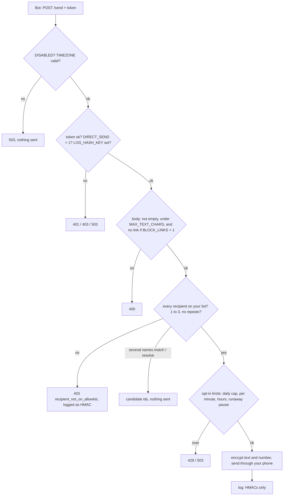

# sms-relay-template

Let your assistant bot send texts from **your own Android phone number** when you tell it to, through a small Cloudflare Worker you own. No texting company is involved: texts leave through your phone and your SIM, using the open-source [SMS Gateway for Android](https://github.com/capcom6/android-sms-gateway) app in its cloud mode.

```
bot --(token)--> your Cloudflare Worker --(encrypted)--> SMS Gateway cloud --> your Android phone --> recipient
you --(email PIN + passkey)--> your private status page (contacts sync, log, approvals)
```

Setup takes about 90 minutes and is written step by step in **[DEPLOY.md](DEPLOY.md)**.

**iPhone?** Set `DELIVERY = "mac"` and an always-on Mac with Messages sends the texts from your number, or `DELIVERY = "shortcut"` for a best-effort iPhone-only path. See **[SETUP-iphone.md](SETUP-iphone.md)**, which also lists what those paths can't do.

## What you get by default
- **Direct send.** You say "text Sam: ...", the bot reads it back, you say yes, and it calls `POST /send`. There is no tap step (`DIRECT_SEND = "1"`).
- **Only people on your list.** The bot can text people in your Google Contacts (synced read-only, daily), numbers you upload, and numbers you list in the `ALLOWLIST` secret. Anything else is refused. One text can go to up to 3 people as **separate 1:1 copies** (`to_names` / `candidate_ids`). A real group thread (one group MMS) is off unless you turn on `GROUP_MMS`.
- **No daily cap, and links are allowed.** Both are switches you can turn on (`DIRECT_DAILY_CAP`, `BLOCK_LINKS`).
- **A private Contacts page** at `https://<APPROVE_HOST>/contacts` behind Cloudflare Access: switch each person on or off for the bot (everyone starts off), star favorites, Sync now, a resolve preview, and sync health. Only the last 4 digits are ever shown. See DEPLOY.md "Contacts page".
- **A private status page** at `https://<APPROVE_HOST>/direct`: status, per-account contact counts (no numbers), a **Sync contacts now** button, and the log.
- **Tap-to-approve** is still built in. Set `DIRECT_SEND = "0"` and the bot can only file requests (`POST /request`, by number or by contact name) that you approve on your phone.
- **Nothing readable in the log.** Numbers are HMACs or masked to the last 4 digits, and the message text is never logged.

## Settings
All settings are `[vars]` in `wrangler.toml`; secrets go in with `npx wrangler secret put NAME`. Switches are exact: `"1"` is on, and a typo in a limit or switch makes the relay refuse sends until you fix it (fail closed).

**Required, no default:**
| Var | Meaning |
|---|---|
| `TIMEZONE` | Your IANA zone, e.g. `"Europe/London"`. Used for day boundaries and times in notices. Missing or not a real zone: every route answers 503 `timezone_not_configured` or `timezone_invalid`. |
| `DEFAULT_COUNTRY_CODE` | Country code put in front of contact numbers saved without a `+` (e.g. `"+44"`, `"+1"`), or `"none"` to keep only numbers already written as `+E.164`. A leading trunk `0` is dropped (`0555 555 0100` with `+44` becomes `+445555550100`); `00…` (or `011…` with `+1`) is read as an international number. Missing or invalid: contact sync refuses (`default_country_code_invalid`) and keeps your previous list. Nothing is ever assumed to be `+1`. |
| `REQUEST_HOST`, `APPROVE_HOST` | Your two hostnames (template: `api.example.com`, `app.example.com`). Unset or equal: everything refused. |
| `ACCESS_TEAM_DOMAIN` | `https://<team>.cloudflareaccess.com` |

**Product defaults** (as shipped):
| Var | Default | Meaning |
|---|---|---|
| `DIRECT_SEND` | `"1"` | The bot sends with no tap to people on your list. `"0"` = tap-to-approve only. |
| `ALLOW_EMAIL_OTP` | `"1"` | Normal setting. See "Sign-in and the passkey" below. |
| `REQUIRED_AMR` | `"otp"` | amr values the Worker accepts when a token carries one. |
| `RUNAWAY_PAUSE` / `RUNAWAY_MAX` | `"0"` / `"10"` | `"1"`: more than MAX direct sends in 60 minutes pauses direct send and texts you; resume on `/direct`. |
| `DISABLED` | `"0"` | `"1"` = kill switch: every route refused; the daily alarm only purges old rows. |
| `GROUP_MMS` | `"0"` | `"1"` lets `/send` send one group MMS (`"group": true`). Needs a valid `OWNER_NUMBER`. Android (SMS Gateway) only: with `DELIVERY = "mac"` or `"shortcut"` a group send gets 409 `group_mms_unsupported_delivery`. See "Group MMS" below and live-test first. |
| `NOTIFY_MODE` | `"sms"` | Notices (sync failures, tap requests, pauses) go to `OWNER_NUMBER` through your phone, or `"ntfy"` with a token. |

**Opt-in switches** (off when unset):
| Var | Effect |
|---|---|
| `BLOCK_LINKS = "1"` | Refuse links in message text on both flows (400 `links_not_allowed`). URLs, bare domains, IPv4 addresses, and look-alikes with hidden characters or odd dots all count. `"0"` or unset = links allowed. Anything else = 503 config error. Contact names and labels that go into your notices are **always** link-checked, whatever this says. |
| `DIRECT_DAILY_CAP = "25"` | Direct sends per `TIMEZONE` day; past it, 429 `direct_daily_cap_reached`. Unset = no cap. |
| `DIRECT_PER_MINUTE_MAX`, `DIRECT_HOURS = "08:00-21:00"` | Burst limit and quiet hours (window may wrap midnight). |
| `DIRECT_NOTIFY_EACH = "1"` | Texts you the name and first 80 characters of each direct send. |
| `DIRECT_LOOKUP_MAX_PER_HOUR` | Lookups and refusals on `/send` per hour (default 30, `"off"` = none). Sends never count. |

**iPhone delivery** (see [SETUP-iphone.md](SETUP-iphone.md); all unset = android):
| Var | Default | Meaning |
|---|---|---|
| `DELIVERY` | unset (`android`) | `"mac"` or `"shortcut"` queues each checked text for your device to claim. Anything else: every route answers 503 `delivery_invalid`. |
| `DEVICE_TOKEN` (secret) | none | Required for mac/shortcut: 32+ characters, different from `REQUEST_TOKEN`. |
| `NOTIFY_MODE` | must be `"ntfy"` | In mac/shortcut, `"sms"` would send your notices through the device itself, so it's refused: 503 `config_invalid`, reason `notify_mode_must_be_ntfy_for_device_delivery`. |
| `UNCLAIMED_EXPIRY_MINUTES` | `"30"` | A text no device claims within this many minutes is dropped, **not sent**, and you get one notice per dropped text. 1..1440; garbage = 503 `config_invalid`. |
| `DIRECT_DAILY_CAP` | `25` in mac/shortcut | Unset means 25 a day here (Apple ID spam-flag risk); `"off"` removes it. |
| `SHORTCUT_PING`, `PING_FROM`, `PING_TO`, `SHORTCUT_NAME` | `"email"`, none, none, `"Relay Send"` | Shortcut path only: how the iPhone is woken. |

**Tap-to-approve limits** (only used by `POST /request`; unset = the default; garbage or out of range = 503 `config_invalid`):
| Var | Default | Range |
|---|---|---|
| `PENDING_CAP_PER_DAY` | 20 | 1–100000 |
| `SEND_CAP_INITIAL` | 5 a day, for `CAP_RAISE_AFTER_DAYS` days from `CAP_START_DATE` | 1–100000 |
| `SEND_CAP_AFTER` | 10 a day | 1–100000 |
| `CAP_RAISE_AFTER_DAYS` | 14 | 0–3650 |
| `REQUEST_TTL_SECONDS` | 900 | 60–86400 |
| `MIN_SECONDS_BETWEEN_SENDS` | 30 | 0–86400 |
| `MAX_TEXT_CHARS` | 640 (both flows) | 1–10000 |

`CAP_START_DATE` (`YYYY-MM-DD`): an invalid value keeps the tap cap at `SEND_CAP_INITIAL`.

**Secrets:** `REQUEST_TOKEN` (the bot's token), `ACCESS_AUD`, `APPROVER_EMAIL`, `GATEWAY_USER`, `GATEWAY_PASS`, `GATEWAY_DEVICE_ID`, `OWNER_NUMBER` (your own number, `+` and country code; notices in sms mode, and required whenever `GROUP_MMS = "1"`), `ALLOWLIST` (`{"+<number>":"Name"}`), `LOG_HASH_KEY` (32+ characters; direct send refuses without it), `GOOGLE_TOKEN_KEY` (32 random bytes; seals the Google client and sign-ins the Worker stores, AES-GCM; `GOOGLE_TOKEN_KEY_OLD` only while rotating, DEPLOY.md section 14). Google accounts are connected on the Contacts page (DEPLOY.md section 9); the older `GOOGLE_CLIENT_ID`, `GOOGLE_CLIENT_SECRET` and one `GOOGLE_RT_<LABEL>` per account still work as a fallback. Encryption: `GATEWAY_MODE` plus either `GATEWAY_PASSPHRASE` (32+ characters; the default for now, because SMS Gateway v1.77.0–v1.77.4 can't decrypt device-key texts) or, opt-in with `config --gateway-mode device-key`, `GATEWAY_PINNED_FINGERPRINT` + `GATEWAY_KEY_VERSION` (`confirm-fingerprint` stores them, nobody types them). DEPLOY.md section 1, steps 7 and 9. Optional: `NTFY_URL` + `NTFY_TOKEN`. `DIRECT_ALLOWLIST` is deprecated: imported once as flagged legacy contacts, then ignored (DEPLOY.md "Contacts page").

## Sign-in and the passkey (read this)
The private page sits behind Cloudflare Access with **email one-time PIN plus a passkey** (Access's independent MFA). The Worker verifies the Access token again itself: RS256 signature against your team's keys, audience, issuer, expiry, and that the email is `APPROVER_EMAIL`. Those checks are always on.

**What it can't check:** Cloudflare's Access token doesn't say which second factor you used. So with `ALLOW_EMAIL_OTP = "1"` (the normal setting) the Worker accepts a valid Access login for your email without proving a passkey was used. **The passkey requirement then rests on your Access policy alone.** If the Access app allowed PIN-only logins, anyone who can read your email within the PIN window could open the page. That's why DEPLOY.md section 3 must be followed exactly, and section 8 checks that a fresh login asks for the passkey. Logins accepted this way are logged as `method=email_otp` or `method=email_otp_or_policy`. Setting `ALLOW_EMAIL_OTP = "0"` makes the Worker require a matching `amr` value from `REQUIRED_AMR`. Cloudflare's documented Access app token carries no `amr`, so in practice that refuses every login; it is there for setups whose tokens do carry one.

## Endpoints
| Host | Route | Auth | Does |
|---|---|---|---|
| request | `POST /send` | `Bearer REQUEST_TOKEN` | Direct send. Body: exactly one of `to` (E.164), `to_name`, `candidate_id`, `to_names` (2–3), `candidate_ids` (2–3), plus `body`. `{"to_name":"Sam","resolve":true}` (or `to_names`) only looks names up and returns `candidate_id`s (never sends). `"group": true` (multi-send only, behind `GROUP_MMS`) sends one group MMS. |
| request | `POST /request` | `Bearer REQUEST_TOKEN` | Tap flow: `{to, text}`, `{to_name, text}` or `{candidate_id, text}`. Stores a pending request and notifies you. Never sends by itself. |
| request | `GET /request/<id>` | `Bearer REQUEST_TOKEN` | State only. |
| approve | `GET /direct`, `POST /direct/sync`, `POST /direct/resume` | Access + same Origin + CSRF | Status page, Sync contacts now, resume after a runaway pause. |
| approve | `POST /contacts/google/start`, `GET /contacts/google/callback`, `POST /contacts/google/disconnect`, `POST /contacts/google/client` | Access (+ same Origin + page CSRF on the POSTs) | Connect Google: state (single use, 10 min, bound to your Access login) + PKCE, scope exactly `contacts.readonly` (anything else is revoked), token sealed in the Durable Object. Disconnect revokes at Google and deletes it. Save client stores the pasted client. 404 on the request host. |
| approve | `GET /contacts`, `GET /contacts/list` | Access | Contacts page; the list carries only the last 4 digits. |
| approve | `POST /contacts/prefs`, `/contacts/enable-all`, `/contacts/migrated-off`, `/contacts/preview` | Access + same Origin (required) + JSON + page CSRF (15 min, bound to the Access identity) | Turn people on/off, star, enable all shown (count must match), turn all migrated off, resolve preview (never sends). On `<API_HOST>` every `/contacts*` path is 404. |
| approve | `GET/POST /approve/<id>` | Access + same Origin + CSRF | Tap approval page. |
| approve | `GET /log` | Access | Last 500 log rows: no text, no full numbers. |
| approve | `POST /contacts` | Access | Optional manual contact upload (`scripts/import-contacts.mjs`). |
| request | `POST /device/next` | `Bearer DEVICE_TOKEN` | `DELIVERY = mac` or `shortcut` only. Claims the oldest queued text (one at a time). The reply carries the number and text: it's the sender. |
| request | `POST /device/result` `{id, lease, outcome}` | `Bearer DEVICE_TOKEN` | One result per claim: `sent`, `sent_unverified`, `not_started` or `uncertain`. Nothing is ever re-queued. |

Answers never contain a phone number, except `/device/next` to your own device. Refusals are JSON `{"error":"<code>"}` (multi-send refusals add `failed: [{index, name?, reason?}]`).

**What `"state":"sent"` means.** SMS Gateway's cloud API accepted the encrypted message for your phone and returned a message id. The cloud then queues it, your phone picks it up and hands it to Android to send. The relay doesn't wait for that, so `sent` is not proof of delivery: a phone that is off or offline sends it when it reconnects, and a carrier can still drop it. Delivery shows in your phone's SMS Gateway app. Any other answer means it did not go.
With `DELIVERY = "mac"` or `"shortcut"` there is no gateway: an accepted text answers 202 `"state":"queued"`, and your device reports the outcome later (`direct_sent`, `direct_send_failed` or `direct_send_uncertain` in the log; see SETUP-iphone.md).

## Multi-send (2–3 people, separate copies)
`{"to_names": ["Sam Lee", "Jo Park"], "body": "…"}` or `{"candidate_ids": [id, id], "body": "…"}`. All or nothing:
- 2 to 3 entries, no repeats (`multi_send_needs_2_to_3`, `multi_send_duplicate`; names are compared after normalization). Two entries that land on the same number are refused too (`multi_send_duplicate_recipient`).
- Every name must match exactly one person on your list. If any name has no match or several, nothing is sent: 409 `multi_send_unresolved` with `failed: [{index, name, reason: "no_match"|"ambiguous"}]`. Use `resolve: true` first to get candidate ids per name; using one id retires that name's other candidates.
- Each person gets their **own 1:1 text** (`textMessage`), in list order, with its own log rows (`batch_ref=… copy=i/n`). If a copy fails, the rest are **stopped** and nothing is retried: 502 `{"state":"partial"|"send_failed","sent":[names],"not_sent":[names]}`. With `DELIVERY = "mac"` or `"shortcut"`, the copies already queued for your device are listed in `"queued":[names]` instead of `sent` (the field is there only when it isn't empty). They count as accepted and will still go out: `{"state":"partial","sent":[],"queued":[names],"not_sent":[names]}`.
- **iPhone delivery (`DELIVERY = "mac"` or `"shortcut"`):** works the same way. Each copy becomes its own queued job, in list order, and the device claims them one at a time, oldest first. The answer is 202 `{"state":"queued","to":[names]}`, and each copy's outcome is logged under its own ref. With `SHORTCUT_PING = "tap"` that is one notification tap per copy.
- Caps count each person and are checked before anything goes out: `DIRECT_DAILY_CAP`, `DIRECT_PER_MINUTE_MAX` and the runaway guard see a batch of 3 as 3. A batch that would go over is refused whole. The lookup/refusal limit counts each name.

## Group MMS (`"group": true`, behind `GROUP_MMS`, default off)
One shared thread instead of separate copies.
- `GROUP_MMS`: unset, `""` or `"0"` = off (`group: true` gets 403 `group_mms_off`). Exact `"1"` = on. Anything else refuses every `/send` with 503 `direct_config_invalid`.
- **Android (SMS Gateway) only.** With `DELIVERY = "mac"` or `"shortcut"`, every `group: true` request is refused with 409 `group_mms_unsupported_delivery`, even with `GROUP_MMS = "1"`. It is checked before the contact list is read, so nothing is sent and no candidate ids, send caps or name lookups are used (like every `/send` refusal, it counts once toward `DIRECT_LOOKUP_MAX_PER_HOUR`). The Mac and Shortcut paths send 1:1 texts only; send separate copies instead.
- **Your own number is never put in the group.** With `GROUP_MMS = "1"`, `OWNER_NUMBER` must be set and in `+E.164` form; otherwise every group request is refused with 503 `config_invalid` (the check never silently turns off). A group that includes your number is refused with 400 `group_includes_owner`.
- Same 2–3 people, same all-or-nothing and duplicate rules as multi-send. Sends **one** gateway request: `mmsMessage` with the text only, every number in `phoneNumbers`, all encrypted. SMS Gateway builds one MMS with every number in To, which phones show as a group thread.
- Needs **SMS Gateway v1.74.0 or later** (MMS sending was added in v1.74.0) and mobile data on the phone. MMS has no delivery report, so `sent` is the final state. A gateway failure is 502 `send_failed`, with no retry and no fallback to copies.
- **Live-test before turning it on:** one text-only group to two numbers you control. Check that each phone shows one thread listing the others, and that a reply reaches everyone. If not, leave it off and use separate copies.

## Tap requests by name
With tap-to-approve (`DIRECT_SEND = "0"`), the bot can file `{"to_name": "Sam Lee", "text": "…"}` or `{"candidate_id": "…", "text": "…"}` instead of a number. The name is looked up in the same list `/send` uses (contacts switched on in the Contacts page, then `ALLOWLIST`). Exactly one match files the request (202, with `"to": "<name>"`); no match answers `{"state":"no_match"}` and several matches answer `{"state":"ambiguous","candidates":[…]}`, and neither files anything. Candidate ids from `/send` lookups work too, and are single use. At approve time the number must still be on that list. Filing by name needs `LOG_HASH_KEY` (503 `config_invalid` without it). Filing by number (`{to, text}`) is unchanged and still needs `ALLOWLIST`, at filing and at approval. One recipient per tap request.

**Tap-only setups:** with `DIRECT_SEND = "0"`, `/request` by name can still reach anyone on the full send list (every contact switched on in the Contacts page, plus `ALLOWLIST`), and each one still needs your tap to approve.

## How a direct send is checked


## Safety notes
- **Device token:** with `DELIVERY = mac` or `shortcut`, `DEVICE_TOKEN` can only claim texts that already passed every check; it can't create one. It must differ from `REQUEST_TOKEN`, and each one rotates on its own.
- **Who can send:** anyone holding `REQUEST_TOKEN` can text anyone on your list, with no tap and (by default) no cap. Guard it like a password; the kill switches are in DEPLOY.md section 13.
- **Encryption:** text and number are encrypted end to end to your phone. Setup uses passphrase mode for now (DEPLOY.md section 1 step 7: SMS Gateway v1.77.0–v1.77.4 can't decrypt device-key texts). In device-key mode (opt-in) the relay encrypts to the phone's key (RSA-OAEP + AES-256-GCM) and refuses to send until you pin its fingerprint and version (`gateway-check`, then `confirm-fingerprint`), and again whenever the key changes. Passphrase mode is AES-256-CBC, PBKDF2-SHA1 at 100,000 iterations, the Workers maximum; the 32+ character passphrase is what makes it strong).
- **Contacts:** only display name, given name and phone numbers (not fax or pager) are stored. Emails, notes and addresses never are.
- **Retention:** tap request text is deleted after 7 days; log rows (no text) after 12 months.
- **CPU:** a passphrase-mode send costs about 58 ms of CPU inside the Durable Object. If you see error 1102 or "exceeded CPU", move to Workers Paid.

## Development
```sh
npm ci --legacy-peer-deps
npm test             # Worker tests in workerd (gateway, Access and Google mocked; real network blocked) + Node tests
npm run typecheck
npm run mutation     # checks the unmutated suite passes first, then breaks one guard at a time and requires a test to fail for every one
```
Test data is fake: `TEST-ONLY-…` tokens, `example.com` / `example.test` hosts, and numbers in the fictional 555-01xx range. A scan after every Worker test fails the test if any response, console line or log row contains something shaped like a phone number.

## Roadmap
- iPhone pickup: built (SETUP-iphone.md). The Mac path has not yet been run on a real Mac by the maintainers; treat it as beta until it has.

## License
MIT. See [LICENSE](LICENSE).
