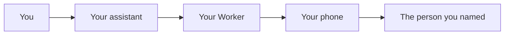

# GrokBot Texting

This repository is a template you run yourself. Your assistant can send texts from **your own phone number**. The texts leave through your phone and your SIM. No texting company is in the middle.

## What it does

You say who to text and what to say. Your assistant reads it back, you agree, and your phone sends it. A private page, which only you can open, is where you choose who is allowed and where you read a log. The log never keeps the message text or a full phone number.

## How it works

Your assistant talks to a small site you host on Cloudflare (a Worker). The Worker checks the request, then your phone sends the text. On Android, the phone app is [SMS Gateway for Android](https://github.com/capcom6/android-sms-gateway), in its cloud mode.

## What you need

- An Android phone with a SIM that can send texts. It stays on, online, and charged.
- A computer: Mac, Linux, or Windows.
- A domain name, or a few minutes to buy one.
- A Google account, if you want the bot to use those contacts.
- About 90 minutes the first time.

An iPhone can send instead. That needs a Mac that stays on, or a Shortcut on the phone. The limits of those paths are in [SETUP-iphone.md](SETUP-iphone.md).

## Start setup

Follow **[docs/SETUP.md](docs/SETUP.md)** from Step 1. The steps are numbered, and they end at a test text.

## What you can turn on

By default the bot texts only people you have switched on. One text can go to one person, or to two or three people as separate texts. There is no daily cap, and links are allowed. You can turn on a shared group thread (Android only), set a daily cap, block links, or require a tap on your phone before anything sends. Every switch and secret is in **[SETTINGS.md](SETTINGS.md)**.

## Direct send

By default there is no tap on your phone. You agree in the chat, and the text goes out. The checks, in order, are the decision table in [SETTINGS.md](SETTINGS.md#how-a-direct-send-is-checked).

## Group MMS

A shared group thread is off until you turn it on, and it works only from an Android phone. Live-test it before you rely on it. The rules are in [SETTINGS.md](SETTINGS.md#group-mms-group-true-behind-group_mms-default-off).

## A few safety notes

- Anyone who has the bot's token can text anyone on your list. Treat that token like a password. How to stop sending is in [DEPLOY.md section 13](DEPLOY.md#13-kill-switch-and-rollback).
- The private page asks for an email PIN and a passkey. With the normal setup, the passkey requirement rests on your Cloudflare Access policy. [DEPLOY.md section 3](DEPLOY.md#3-lock-the-private-page-with-cloudflare-access) is the one to follow exactly. The full note is in [SETTINGS.md](SETTINGS.md#sign-in-and-the-passkey-read-this).
- Encrypting a text stretches the passphrase 100,000 times, which is the most a Cloudflare Worker allows. If you see error 1102 or "exceeded CPU", move to Workers Paid.

## Changing the code

See [CONTRIBUTING.md](CONTRIBUTING.md). The commands, endpoints, and send rules are in [SETTINGS.md](SETTINGS.md).

## License

MIT. See [LICENSE](LICENSE).
