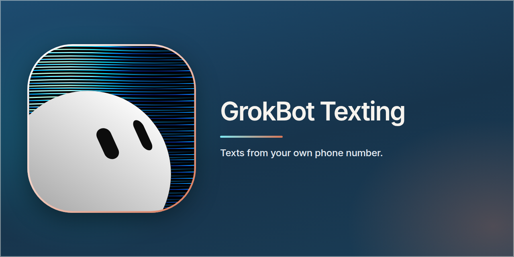
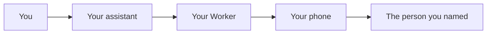

# GrokBot Texting

This repository is a template you run yourself. Your assistant can send texts from **your own phone number**. The texts leave through your phone and your SIM. No texting company is in the middle.

## What it does

You say who to text and what to say. Your assistant reads it back, you agree, and your phone sends it. A private page, which only you can open, is where you choose who is allowed, approve a text, and read a log. The audit log never keeps the message text or a full phone number.

## Inbound texts

Recording inbound texts is off until you turn it on. With `CAPTURE_INBOUND = "0"` and `STORE_MESSAGE_BODIES = "0"` (the template) the Worker does not keep a message body, and `POST /messages` refuses. If you set both to `"1"` and set the `LOG_ENC_KEY` secret (32 bytes, not the same value as `LOG_HASH_KEY`), an inbound text can be stored as AES-GCM ciphertext of the number and the body, plus the time, the direction, and the last 4 digits. Outbound texts can store the same way when `STORE_MESSAGE_BODIES = "1"`. Without the key, nothing is written for an inbound text and a send still goes out with at most the last 4 digits saved.

Inbound rows are deleted after 30 days and outbound rows after 90 days. The daily job does that, and so does the Durable Object alarm. To delete them all now, sign in on the private page and `POST /messages/purge` with `{"confirm":"purge-all"}`. Unknown numbers are never added to your contacts.

## How it works

Your assistant talks to a small site you host on Cloudflare (a Worker). The Worker checks the request, then your phone sends the text. On Android, the phone app is [SMS Gateway for Android](https://github.com/capcom6/android-sms-gateway), in its cloud mode.

## What you need

- An Android phone with a SIM that can send texts. It stays on, online, and charged.
- A computer: Mac, Linux, or Windows.
- A domain name, or a few minutes to buy one.
- A Google account, if you want the bot to use those contacts.
- About 90 minutes the first time.

An iPhone can send instead. That needs a Mac that stays on, or a Shortcut on the phone. The limits of those paths are in [SETUP-iphone.md](SETUP-iphone.md).

## Start setup

Follow **[docs/SETUP.md](docs/SETUP.md)** from Step 1. The steps are numbered, and they end at a test text.

## What you can turn on

By default the bot texts only people you have switched on. One text can go to one person, or to two or three people as separate texts. There is no daily cap, and links are allowed. You can turn on a shared group thread (Android only), set a daily cap, block links, or require a tap on your phone before anything sends. Every switch and secret is in **[SETTINGS.md](SETTINGS.md)**.

## Direct send

By default there is no tap on your phone. You agree in the chat, and the text goes out. The checks, in order, are the decision table in [SETTINGS.md](SETTINGS.md#how-a-direct-send-is-checked).

## Group MMS

A shared group thread is off until you turn it on, and it works only from an Android phone. Live-test it before you rely on it. The rules are in [SETTINGS.md](SETTINGS.md#group-mms-group-true-behind-group_mms-default-off).

## iCloud contacts

The bot can read your iCloud contacts into its address book. It only reads them, and a synced contact stays switched off until you turn it on, the same as Google contacts.

1. At https://appleid.apple.com, go to Sign-In and Security, then App-Specific Passwords, and make one.
2. Run setup. It asks for your Apple ID, then the app-specific password on a masked card. Both are saved as Worker secrets, never as vars. To set them by hand instead, run `npx wrangler -c .relay-local/wrangler.toml secret put ICLOUD_APPLE_ID`, then the same command with `ICLOUD_APP_PASSWORD`.
3. On the Contacts page, press Sync. iCloud shows up as the `ICLOUD` list, after Google accounts and before an uploaded list.

If you see `icloud_auth_failed`, make a new app-specific password and set it again. If only one of the two secrets is set, you see `icloud_secret_missing`. To stop syncing, delete both secrets. The next sync then deletes the iCloud list.

## Outlook contacts

Optional, read-only address-book sync from Outlook.com or Microsoft 365 through Microsoft Graph. It works like the Google sync: you sign in on the contacts page, and the refresh token is sealed with `GOOGLE_TOKEN_KEY` before it is stored. Synced numbers go into the address book only. They start OFF and never widen who can be texted.

1. In the Microsoft Entra admin center, register an app for "accounts in any organizational directory and personal Microsoft accounts". Add a Web redirect URI, which the contacts page shows (`https://<approve host>/contacts/outlook/callback`). Add the delegated Graph permissions `Contacts.Read` and `offline_access`, and nothing else.
2. Create a client secret, then run `wrangler secret put MS_CLIENT_ID` and `wrangler secret put MS_CLIENT_SECRET`.
3. On the contacts page, open **Outlook accounts**, enter a label (for example `work`), and connect. Contacts are listed as `OUTLOOK_<LABEL>`.

`MS_ACCOUNTS` (a var) plus an `MS_RT_<LABEL>` secret are only needed to seed an account without the page, like `GOOGLE_ACCOUNTS`. Disconnect deletes the stored token and that account's contacts. Microsoft has no app-side revoke for this scope, so also remove the app at account.microsoft.com/privacy/app-access.

## A few safety notes

- Anyone who has the bot's token can text anyone on your list. Treat that token like a password. How to stop sending is in [DEPLOY.md section 13](DEPLOY.md#13-kill-switch-and-rollback).
- The private page asks for an email PIN and a passkey. With the normal setup, the passkey requirement rests on your Cloudflare Access policy. [DEPLOY.md section 3](DEPLOY.md#3-lock-the-private-page-with-cloudflare-access) is the one to follow exactly. The full note is in [SETTINGS.md](SETTINGS.md#sign-in-and-the-passkey-read-this).
- Encrypting a text stretches the passphrase 100,000 times, which is the most a Cloudflare Worker allows. If you see error 1102 or "exceeded CPU", move to Workers Paid.

## Changing the code

See [CONTRIBUTING.md](CONTRIBUTING.md). The commands, endpoints, and send rules are in [SETTINGS.md](SETTINGS.md).

**Personal-data scan.** `npm run check:pii` (also run by the pre-push hook and CI) reads its term list from `PII_TERMS` (comma or newline list; the CI secret), `PII_TERMS_FILE`, or a gitignored `.pii-terms` at the repo root. The format is in `scripts/ci/pii-terms.example` (fake entries). Real terms are never committed or printed; a hit shows only the first 2 characters plus `***`. With no list, CI fails closed (`PII_REQUIRE_TERMS=1`); a local run prints a loud WARNING and checks only phone numbers and commit emails. A push with an `@gmail.com` author or committer email is rejected: use your `users.noreply.github.com` address. Commit names, emails and messages are checked only for the pushed range (`origin/main..HEAD`), so older history on main never fails a push.

## Support

The Contacts, Approve, Direct, and Log pages include that link in the footer. The text is `SUPPORT_LABEL` and the address is `SUPPORT_URL`, both in `src/pages.ts`.

## License

MIT. See [LICENSE](LICENSE).
